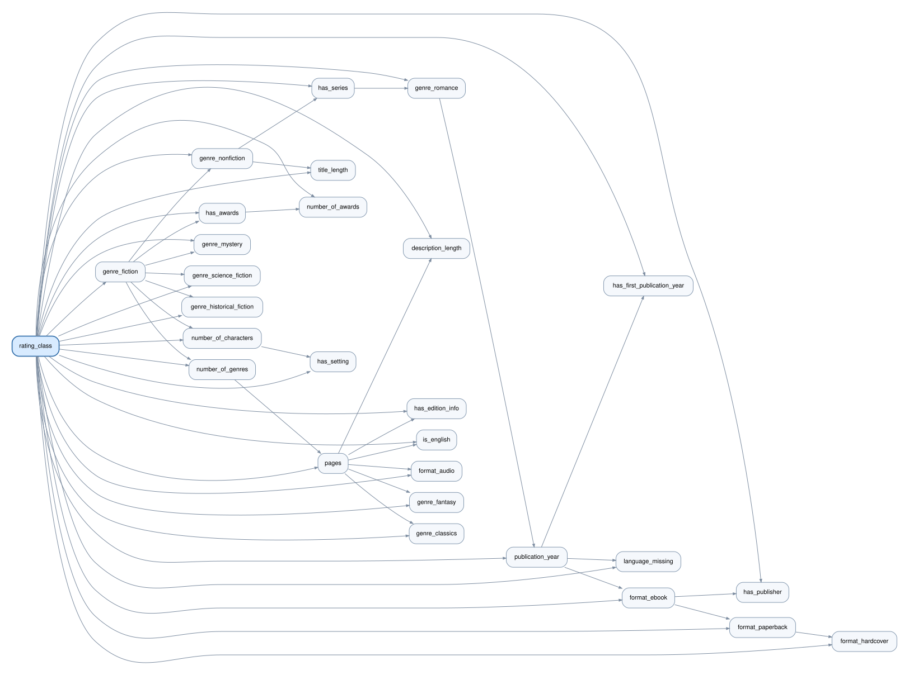

# What makes a book highly rated?

**Exploring book ratings through interpretable machine learning in Weka.**

[](https://www.cs.waikato.ac.nz/ml/weka/)
[](#the-question)
[](#project-status)

A machine learning project by **[Borja Barahona Gómez](https://github.com/bbarahon)**, developed for Practical Applications 1 and 2 of the MSc in Data Science at Universidad Politécnica de Madrid.

The project investigates whether bibliographic metadata can distinguish books rated **4 stars or above** from those rated below 4. It compares model families and feature-selection strategies, with an emphasis on honest evaluation and understanding what the models learn.

[Methodology](docs/methodology.md) · [Data dictionary](docs/data-dictionary.md) · [Weka guide in Spanish](docs/weka-guide.es.md) · [Results](results/README.md)

## The question

Can genre, publication history, format and other book metadata help predict a book's rating category?

| Target | Definition |
| --- | --- |
| `high_rating` | Observed average rating ≥ 4 |
| `low_rating` | Observed average rating ≥ 1 and < 4 |

Books with no ratings are excluded. The threshold is fixed before model comparison. This is a **retrospective classification task** on an existing book catalogue; it does not establish causes of high ratings or demonstrate prediction before publication.

## Dataset at a glance

The following counts describe the corrected local dataset prepared for this project. They are **data-audit statistics, not model performance**.

| Item | Value |
| --- | ---: |
| Original records | 52,478 |
| Records after excluding books without ratings | 52,407 |
| Predictors | 33 |
| High-rating books | 28,695 · 54.75% |
| Low-rating books | 23,712 · 45.25% |

The source is a preprocessed *Best Books Ever* dataset. Its exact upstream release, collection date and redistribution terms still need to be documented. Data files are therefore not bundled in this repository. See [data provenance and local setup](data/README.md).

### What was improved

- Restored numeric publication years from the available CSV instead of using the ARFF's precomputed intervals.
- Recovered the first-publication year and added missingness and date-consistency indicators.
- Added the gap between edition and first publication when both dates are consistent.
- Converted `1 page` to 1 and zero-page values to missing data.
- Removed 71 unrated books and the redundant `has_awards` flag.
- Retained the existing eight genre indicators and `has_series`; added no text or series-position features.

Some earlier preprocessing cannot be reversed reliably. For example, real 304-page books cannot be distinguished from earlier imputations without the original source. [Read the limitations](docs/methodology.md#limitations).

## Experimental design

The planned comparison crosses model families with four feature-selection settings:

| Setting | Implementation |
| --- | --- |
| All admissible predictors | No feature selection |
| Univariate filter | `InfoGainAttributeEval` + `Ranker` |
| Multivariate filter | `CfsSubsetEval` + `BestFirst` |
| Wrapper | `WrapperSubsetEval` + a documented search strategy |

**Candidate classifiers:** IBk, JRip, SMO, MultilayerPerceptron, J48, Logistic, NaiveBayes and BayesNet with TAN search. Ensembles include Bagging, AdaBoostM1, RandomForest and Vote. The final list must cover the algorithms taught in the current course.

A reserved test set is used only after configurations are fixed. Imputation, scaling and feature selection are learned within training folds. Accuracy is reported alongside balanced accuracy, F1, per-class recall, ROC-AUC and computational cost.

The full-sample majority proportion is **54.75%**. This is a descriptive reference, not a measured test score: the final ZeroR baseline must be trained and evaluated on the same split as the other models.

## Project status

| Component | Status |
| --- | --- |
| Data audit and corrected ARFF | Prepared locally; validation script provided |
| Feature dictionary and evaluation protocol | Documented |
| Existing Bayesian-network figure | Available; training provenance not documented |
| Cross-validated model comparison | Pending |
| Held-out test metrics and final conclusions | Pending |

No model ranking, accuracy gain or causal conclusion is claimed at this stage.

<details>
<summary><strong>View the existing Bayesian-network figure</strong></summary>



This figure was already present in the repository. Its training configuration, data version and evaluation split have not been recorded here. It is retained as a visual reference, not evidence of validated performance. Directed edges should not be interpreted as causal effects.

</details>

## Getting started

1. Obtain the corrected ARFF and place it at `data/local/goodreads_weka_preprocessed.arff` as described in [data setup](data/README.md).
2. Validate its schema and basic invariants with Python 3:

   ```bash
   python scripts/validate_dataset.py data/local/goodreads_weka_preprocessed.arff
   ```

3. Open the ARFF in **Weka Explorer** and select `rating_class` as the class.
4. Follow the [step-by-step Weka guide](docs/weka-guide.es.md) to reserve the test set and build training-only preprocessing pipelines.
5. Record configurations, outputs and metrics using the [results template](results/metrics.csv).

The validation script uses only Python's standard library. Weka and Java are separate requirements; record their exact versions with each experiment.

## Repository map

| Path | Purpose |
| --- | --- |
| [`docs/methodology.md`](docs/methodology.md) | Task definition, evaluation design and limitations |
| [`docs/data-dictionary.md`](docs/data-dictionary.md) | All 33 predictors and the target |
| [`docs/weka-guide.es.md`](docs/weka-guide.es.md) | Practical instructions in Spanish |
| [`data/README.md`](data/README.md) | Dataset provenance, fingerprint and acquisition notes |
| [`scripts/validate_dataset.py`](scripts/validate_dataset.py) | Local ARFF checks |
| [`results/`](results/README.md) | Reporting conventions and empty metric template |
| [`figures/`](figures/README.md) | Existing visual material and provenance notes |

## Author and reuse

**Borja Barahona Gómez** · Physics graduate and MSc Data Science student · [GitHub](https://github.com/bbarahon)

This repository retains its existing [CC0 1.0 dedication](LICENSE). It does not establish redistribution rights for third-party Goodreads or upstream dataset content. Source attribution and dataset terms must be checked separately before distributing data.
